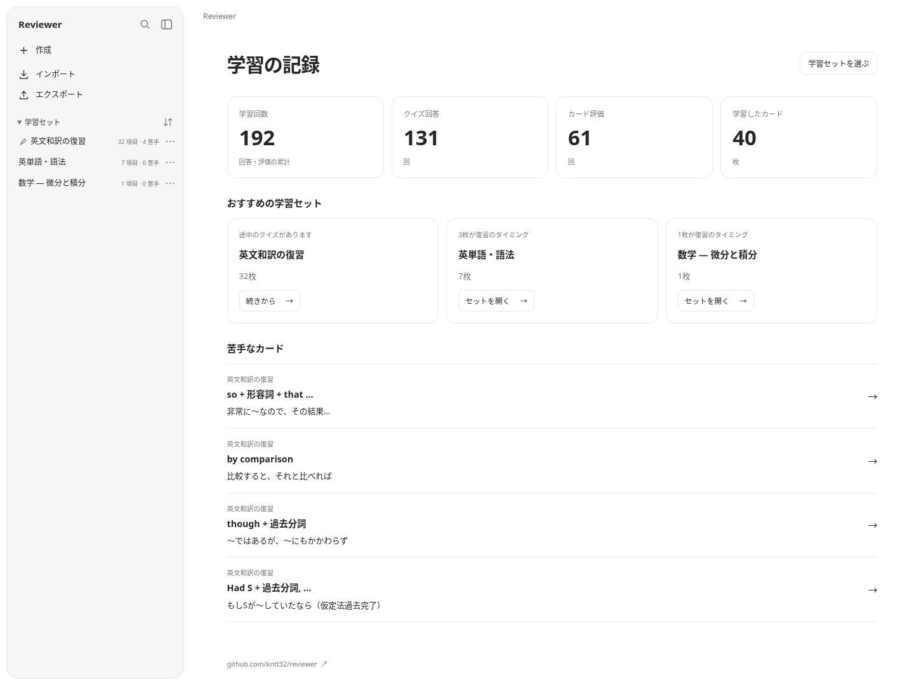
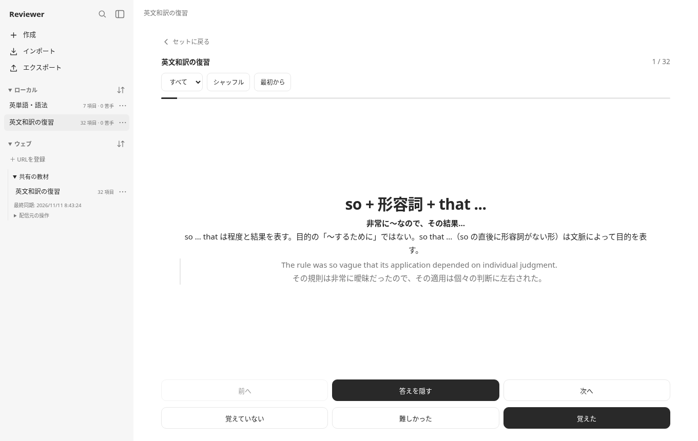
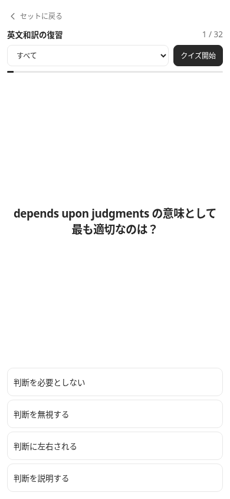

  

<h1 align="center">Reviewer</h1>

思い出して、解いて、続きから。 自分の教材で学べる、単語カードと選択式・自由回答クイズの復習ツール。

  <a href="https://kntt.pages.dev/tools/reviewer">アプリを開く ↗</a> ·
  <a href="#はじめる">はじめる</a> ·
  <a href="docs/development.md">開発・ビルド</a>

  
  
  
  
  

## できること

- **単語カードとクイズ** — 選択式・自由回答で復習。
- **画像・数式** — 図や数式を含む教材にも対応。
- **学習ダッシュボード** — 記録を振り返り、おすすめや苦手なカードから学習。
- **続きから再開** — カードの位置やクイズの回答状況を保存。
- **教材の作成・共有** — JSONの取り込み・書き出し。

PC・タブレット・スマートフォンに対応。ライト／ダーク表示を切り替えられます。

<table>
  <tr><th>単語カード</th><th>モバイルのクイズ</th></tr>
  <tr>
    <td width="75%"></td>
    <td width="25%"></td>
  </tr>
</table>

## はじめる

1. [アプリを開く](https://kntt.pages.dev/tools/reviewer)。
2. 教材を作成するか、JSONをインポートする。
3. セットを選んで学習する。
