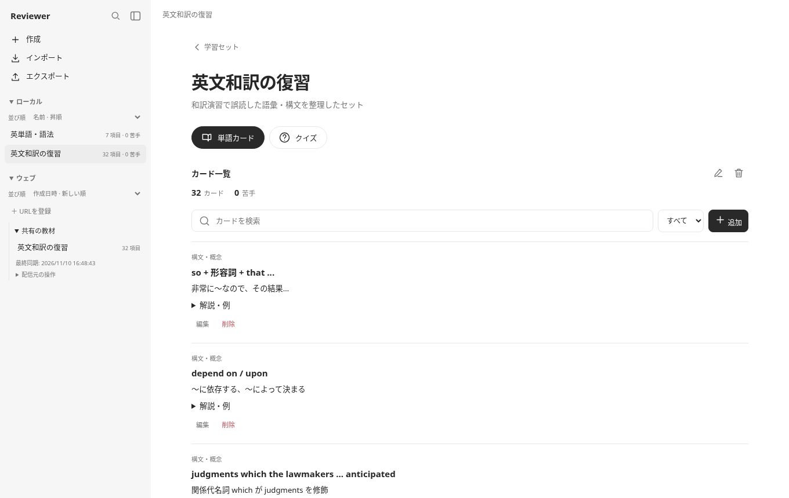

<p align="center">
  
</p>
<h1 align="center">Reviewer</h1>
<p align="center">思い出して、解いて、続きから。<br>自分の教材で学べる、単語カードと4択クイズの復習ツール。</p>
<p align="center">
  <a href="https://kntt.pages.dev/tools/reviewer">アプリを開く ↗</a> ·
  <a href="#使い方">使い方</a> ·
  <a href="docs/development.md">開発・ビルド</a>
</p>
<p align="center">
  <a href="https://github.com/kntt32/reviewer/actions/workflows/publish.yml"></a>
</p>



## できること

- **単語カード** — 表面から答えを思い出し、「覚えていない・難しかった・覚えた」で記録。
- **4択クイズ** — 間違えた問題を再出題。解説を読みながら苦手を復習。
- **続きから再開** — カードの順序や位置、クイズの回答状況を保存。再読み込み後も続きを学習。
- **ローカルとウェブの教材** — 自分で作成したりJSONを読み込んだり、公開URLの教材を同期したり。
- **整理しやすいサイドバー** — 検索、並び替え、セクションの折りたたみ。閉じれば学習画面を広く使える。

PC・タブレット・スマートフォンに対応し、端末設定に合わせてライト／ダーク表示を切り替えます。アプリ本体は、外部ライブラリ不要の**単一HTML**です。

<table>
  <tr><th>単語カード</th><th>モバイルのクイズ</th></tr>
  <tr>
    <td width="75%"></td>
    <td width="25%"></td>
  </tr>
</table>

<sub>スクリーンショットはデモ教材を使って撮影しています。</sub>

## 使い方

1. [Reviewer を開く](https://kntt.pages.dev/tools/reviewer)。
2. サイドバーの「作成」で教材を作るか、「インポート」でJSONを読み込む。
3. 学習セットを選んで「単語カード」または「クイズ」を始める。

虫眼鏡ボタンから教材を検索できます。サイドバー上部の開閉ボタンを押すと教材一覧を隠し、右側のボタンから再表示できます。モバイルでは教材を選ぶとサイドバーが閉じます。

### 公開URLの教材を使う

「ウェブ → URLを登録」で、セクション名とJSONのURLを登録します。登録時・起動時・手動の「同期」で更新し、配信元ごとに教材をまとめます。取得に失敗したときも、保存済みの教材で学習できます。

配信元はブラウザからの取得を許可する **CORS設定**が必要です。GitHubのRaw URLなどが使えます。ウェブ教材を編集したいときは、配信元の操作から「ローカルへコピー」を選んでください。

### JSONの例

```json
{
  "sets": [
    {
      "title": "英語の復習",
      "description": "語句と構文を少しずつ",
      "items": [
        {
          "type": "grammar",
          "term": "provided that ...",
          "meaning": "〜という条件で、〜ならば",
          "explanation": "条件を表す接続表現。",
          "example": "You may leave early, provided that your work is finished.",
          "translation": "仕事が終わっているなら、早く帰ってもよい。",
          "question": "provided that の意味は？",
          "options": ["〜という条件で", "〜にもかかわらず", "〜した結果", "〜する代わりに"],
          "answer": 0
        }
      ]
    }
  ]
}
```

`answer` は0始まりの番号です。「インポート」内には、AIに教材JSONを作ってもらうためのプロンプトをコピーする機能もあります。

### 保存とバックアップ

教材・学習履歴・途中の進捗は、利用中のブラウザ内に保存します。アカウント登録は不要です。別の端末やブラウザへの自動同期はありません。

「エクスポート」で教材JSONを書き出し、「バックアップ」で履歴や進捗を含む保存データを書き出せます。ブラウザのデータを削除する前や、教材を移す前にバックアップしてください。バックアップの取り込みはローカル教材として行われ、ウェブURLの登録や途中の学習位置は再設定が必要です。

## 開発

Node.js 24で実行できます。依存パッケージのインストールは不要です。

```bash
npm test
npm run build
```

`src/reviewer.html` を編集し、ビルドで `dist/reviewer.html` を生成します。CSS・JavaScript・アイコン・Web App Manifestを1つのHTMLにまとめます。

詳しい構成、ブラウザテスト、教材形式、自動配信の設定は[開発ガイド](docs/development.md)を参照してください。

## ライセンス

[MIT](LICENSE)
